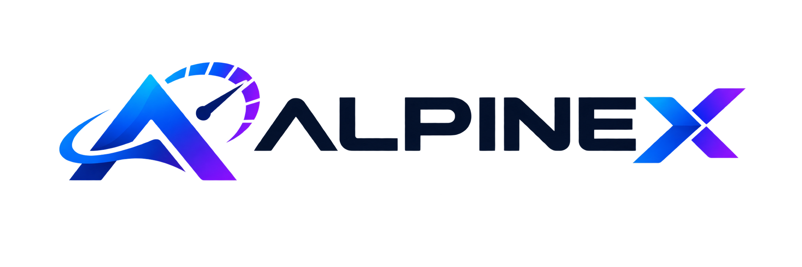

# ALPINEX — Logo & Visual Identity

> **Product:** ALPINEX  
> **Descriptor:** API Testing & Performance Platform  
> **Purpose:** Open-source platform for API functional testing, load testing, stress testing, and performance testing.

## Primary logo



Use this as the primary horizontal logo lockup. Keep the symbol and wordmark together wherever possible.

## Wordmark typography

- **Typeface:** [Sora](https://fonts.google.com/specimen/Sora)
- **Weight:** ExtraBold (`800`)
- **Letter spacing:** approximately `-2.5px` at a 48px font size
- **Wordmark color:** Midnight Navy for `ALPINE`
- **Accent:** Gradient for the final `X`

The generated logo image is a visual reference. For production use, recreate the symbol as vector SVG and use the CSS wordmark below so the text remains crisp and editable.

## Brand color palette

| Name | Hex | Intended use |
|---|---|---|
| Midnight Navy | `#07152F` | Main wordmark and dark UI surfaces |
| Electric Cyan | `#06B6D4` | Start of the `X` gradient |
| Electric Blue | `#2563EB` | Middle of the `X` gradient |
| Violet | `#7C3AED` | End of the `X` gradient |

### X gradient

Apply the gradient only to the final `X`, not to the entire wordmark:

```css
background: linear-gradient(
  115deg,
  #06B6D4 0%,
  #2563EB 48%,
  #7C3AED 100%
);
-webkit-background-clip: text;
background-clip: text;
color: transparent;
```

## HTML and CSS implementation

```html
<div class="alpinex-logo" aria-label="ALPINEX">
  ALPINE<span class="x">X</span>
</div>
```

```css
@import url('https://fonts.googleapis.com/css2?family=Sora:wght@700;800&display=swap');

.alpinex-logo {
  display: inline-flex;
  align-items: center;
  font-family: 'Sora', sans-serif;
  font-size: 48px;
  font-weight: 800;
  letter-spacing: -2.5px;
  line-height: 1;
  color: #07152F;
}

.alpinex-logo .x {
  background: linear-gradient(
    115deg,
    #06B6D4 0%,
    #2563EB 48%,
    #7C3AED 100%
  );
  -webkit-background-clip: text;
  background-clip: text;
  color: transparent;
}
```

## Logo usage guidelines

1. Keep the `ALPINE` wordmark in Midnight Navy on light backgrounds.
2. Keep the `X` gradient from Electric Cyan through Electric Blue to Violet.
3. On dark backgrounds, change `ALPINE` to white (`#FFFFFF`) while preserving the `X` gradient.
4. Do not apply the gradient to the complete wordmark.
5. Avoid excessive glow, bevel, or drop-shadow effects.
6. Preserve the logo's proportions and clear space.
7. Do not stretch, rotate, or recolor individual letters.
8. Use the symbol and wordmark together for the primary lockup.

## Recommended dark-background variant

```css
.alpinex-logo--dark {
  color: #FFFFFF;
}
```

## Production asset notes

- The PNG included alongside this Markdown file is the primary-logo visual reference.
- Recreate the mountain/speedometer symbol as SVG before using it at small sizes or in production interfaces.
- Use the Sora CSS wordmark for responsive rendering rather than embedding the text in a raster image.
- Create a dedicated simplified symbol-only SVG for favicon and application icons.

---

**Brand identity baseline:** ALPINEX — API Testing & Performance Platform.
