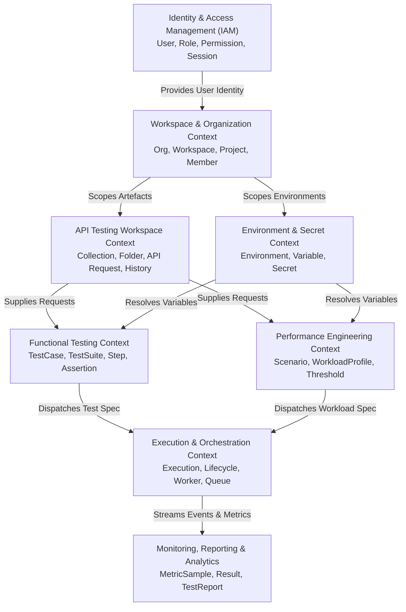

# ALPINEX — Domain-Driven Design Specification

## 1. Bounded Context Map

ALPINEX is divided into 8 distinct Bounded Contexts to guarantee separation of concerns, engine independence, and strict domain boundaries.



---

## 2. Ubiquitous Language Glossary

| Term | Ubiquitous Language Definition | Context |
|---|---|---|
| **Organization** | The top-level legal or administrative tenant owning billing, platform audit logs, and global policies. | IAM / Org |
| **Workspace** | A shared operational boundary grouping projects and team members with specific workspace roles. | Workspace |
| **Project** | An isolated testing namespace containing API collections, environments, test cases, and performance scenarios. | Workspace |
| **API Request** | A declarative specification of an HTTP call (method, URL template, headers, query params, body, auth). | API Workspace |
| **Collection** | A hierarchical tree of folders and API Requests designed for reuse and export/import. | API Workspace |
| **Environment** | A named set of key-value pairs (variables & secrets) that dynamically parameterize requests across stages (Dev, Staging, Prod). | Environment |
| **Secret** | A sensitive variable value encrypted at rest and masked in logs/UI. | Environment |
| **Test Case** | A functional test specification composed of a request reference, execution steps, pre/post conditions, and assertions. | Functional Testing |
| **Assertion** | A formal declarative check on a response (status, duration, headers, JSONPath, schema). | Functional Testing |
| **Test Suite** | An ordered collection of Test Cases executed sequentially or conditionally with shared variables. | Functional Testing |
| **Workload Profile** | A formal distribution of load (Constant VUs, Ramping VUs, Arrival Rate) over stages of time. | Performance |
| **Scenario** | A multi-step user transaction flow combined with think times, pacing, and variable extractions. | Performance |
| **Threshold** | A quantitative pass/fail rule (e.g. `p(95) < 500ms`, `http_req_failed < 0.01`) evaluated against metrics. | Performance |
| **Execution** | An immutable single run instance of a functional suite or performance test, tracked by a unique Execution ID. | Execution |
| **Worker** | An autonomous execution agent that polls/claims tasks from the queue, executes engines (HTTP runner or k6), and streams metrics. | Execution |
| **Metric Sample** | A timestamped, typed telemetry data point emitted during execution (counter, gauge, rate, trend/duration). | Monitoring |
| **Test Report** | An aggregated, frozen historical summary of an execution including pass/fail status, percentiles, errors, and traces. | Reporting |

---

## 3. Aggregate Roots & Domain Invariants

### 3.1 Organization & Project Aggregates
- **Aggregate Root:** `Project`
- **Invariants:**
  1. A Project must belong to exactly one Workspace.
  2. Project name must be unique within its Workspace.
  3. Deleting an active project requires explicit confirmation and cannot occur while an Execution is in state `RUNNING` or `PROVISIONING`.

### 3.2 Environment Aggregate
- **Aggregate Root:** `Environment`
- **Entities / VOs:** `EnvironmentVariable`, `Secret`
- **Invariants:**
  1. Variable names must match pattern `^[a-zA-Z_][a-zA-Z0-9_]*$`.
  2. Secret values are never stored in plaintext; must be encrypted prior to state persistence.
  3. When an Environment is deleted, all associated secret keys must be permanently expunged.

### 3.3 Functional Test Suite Aggregate
- **Aggregate Root:** `TestSuite`
- **Entities / VOs:** `TestCase`, `TestStep`, `Assertion`, `VariableExtraction`
- **Invariants:**
  1. A Test Suite must contain at least one Test Step to be executable.
  2. Step dependencies (chained variables) must not contain circular dependencies.
  3. Assertions must fail closed: an unparsable response or invalid JSONPath expression evaluates to `Status: ERROR` or `Status: FAILED`.

### 3.4 Performance Test Aggregate
- **Aggregate Root:** `PerformanceTest`
- **Entities / VOs:** `Scenario`, `WorkloadProfile`, `ThresholdConfig`
- **Invariants:**
  1. Workload profile must define positive VUs (`> 0`) and valid duration (`> 0s`).
  2. If arrival-rate model is chosen, `time_unit` and `pre_allocated_vus` must be strictly configured.
  3. Workload configuration cannot exceed the platform administrator's quota limit (`max_vus_per_test`, `max_duration`).
  4. At least one Threshold must be specified for automated pass/fail grading.

### 3.5 Execution Aggregate (Core Lifecycle State Machine)
- **Aggregate Root:** `Execution`
- **Entities / VOs:** `ExecutionAssignment`, `ExecutionConfigSnapshot`, `ExecutionStatus`
- **State Machine Invariants:**
```text
  [ DRAFT ]
      │
      ▼
[ VALIDATING ] ──(fail)──► [ FAILED ]
      │
      ▼
  [ QUEUED ] ──(timeout/cancel)──► [ CANCELLED ]
      │
      ▼
[ PROVISIONING ]
      │
      ▼
  [ RUNNING ] ──(stop command)──► [ STOPPING ] ──► [ CANCELLED ]
      │                                                ▲
      ├──(threshold/error abort)───────────────────────┤
      │
      ▼
 [ COMPLETED ] (Terminal)
```
- **Terminal State Invariant:** Once an Execution reaches `COMPLETED`, `FAILED`, `CANCELLED`, `TIMEOUT`, or `ABORTED`, its state is strictly immutable. It cannot transition back to `RUNNING`.

---

## 4. Domain Event Catalogue

All state changes publish domain events via an internal Event Dispatcher:

| Event Name | Aggregate | Payload / Meaning |
|---|---|---|
| `ExecutionCreatedEvent` | Execution | Execution ID, Project ID, Test ID, TriggeredBy |
| `ExecutionValidatedEvent` | Execution | Execution ID, Config Snapshot Hash |
| `ExecutionQueuedEvent` | Execution | Execution ID, Queue Priority, Resource Requirements |
| `ExecutionStartedEvent` | Execution | Execution ID, Worker ID, Start Timestamp |
| `MetricEmittedEvent` | Execution | Execution ID, Metric Name, Value, Timestamp, Tags |
| `ThresholdBreachedEvent` | Execution | Execution ID, Threshold Rule, Current Value |
| `ExecutionCompletedEvent` | Execution | Execution ID, Final Status (Passed/Failed), Summary |
| `ExecutionCancelledEvent` | Execution | Execution ID, Reason, CancelledBy |
| `WorkerHeartbeatReceivedEvent` | Worker | Worker ID, CPU Util, Memory Util, Active Tasks |
| `WorkerOfflineDetectedEvent` | Worker | Worker ID, Last Heartbeat, Reassignment Triggered |
| `SecurityTargetBlockedEvent` | TargetCheck | Execution ID, URL, Reason (Private IP / Unapproved) |
