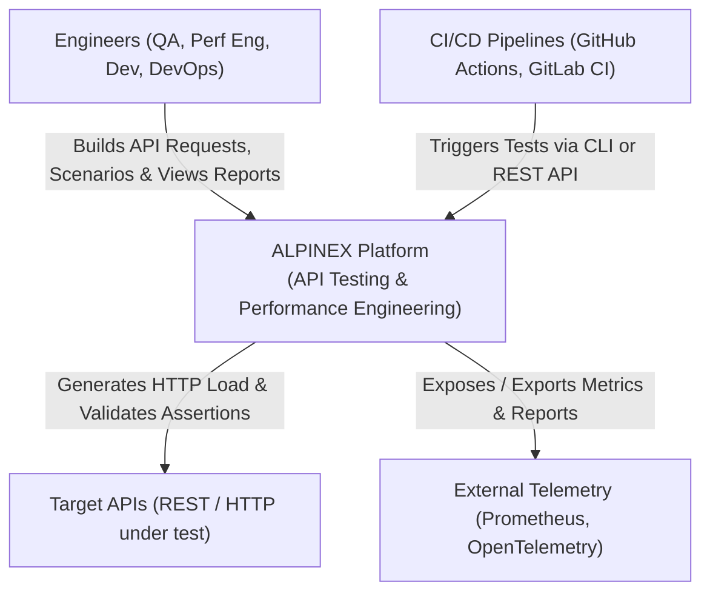
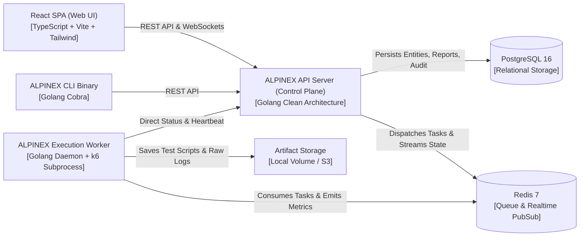

# ALPINEX — C4 Architecture & Clean Architecture Specification

## 1. C4 System Context Diagram (Level 1)



---

## 2. C4 Container Diagram (Level 2)



---

## 3. Clean Architecture Package Structure (Go Backend)

```text
/
├── cmd/
│   ├── api/                     # API Server entry point
│   │   └── main.go
│   ├── worker/                  # Execution Worker entry point
│   │   └── main.go
│   └── cli/                     # CLI tool entry point
│       └── main.go
│
├── internal/
│   ├── core/                    # Core Business Logic (Zero External Dependencies)
│   │   ├── domain/              # Entities, Value Objects, Domain Events, Invariants
│   │   │   ├── iam/             # User, Role, Permission
│   │   │   ├── workspace/       # Org, Workspace, Project
│   │   │   ├── api/             # Request, Collection, Folder
│   │   │   ├── environment/     # Environment, Variable, Secret
│   │   │   ├── functional/      # TestCase, TestSuite, Step, Assertion
│   │   │   ├── performance/     # Scenario, WorkloadProfile, Threshold
│   │   │   ├── execution/       # Execution, Status, Lifecycle, Assignment
│   │   │   └── audit/           # AuditLog, EventType
│   │   │
│   │   ├── ports/               # Interfaces (Inbound & Outbound)
│   │   │   ├── in/              # Driving Ports (Use Cases / Application Services)
│   │   │   │   ├── auth_usecase.go
│   │   │   │   ├── workspace_usecase.go
│   │   │   │   ├── collection_usecase.go
│   │   │   │   ├── functional_usecase.go
│   │   │   │   ├── performance_usecase.go
│   │   │   │   └── execution_usecase.go
│   │   │   └── out/             # Driven Ports (SPI / Repositories / Engines)
│   │   │       ├── repositories.go
│   │   │       ├── execution_engine.go
│   │   │       ├── queue_port.go
│   │   │       ├── event_publisher.go
│   │   │       └── metrics_collector.go
│   │   │
│   │   └── services/            # Use Case Implementations (Orchestrators)
│   │       ├── auth_service.go
│   │       ├── collection_service.go
│   │       ├── functional_service.go
│   │       ├── performance_service.go
│   │       └── execution_orchestrator.go
│   │
│   └── adapters/                # Infrastructure & Delivery (Implements Ports)
│       ├── handlers/            # Inbound Transport Adapters
│       │   ├── http/            # REST HTTP Handlers (Fiber / Chi)
│       │   │   ├── auth_handler.go
│       │   │   ├── collection_handler.go
│       │   │   ├── execution_handler.go
│       │   │   └── middleware/  # JWT Auth, RBAC, Correlation ID, Logger
│       │   └── websocket/       # Real-time Metrics & Log Streamer
│       │
│       ├── persistence/         # Outbound Persistence Adapters (PostgreSQL)
│       │   ├── postgres/
│       │   │   ├── db.go
│       │   │   ├── user_repo.go
│       │   │   ├── collection_repo.go
│       │   │   ├── execution_repo.go
│       │   │   └── migrations/  # SQL schema migrations
│       │
│       ├── queue/               # Redis Queue & PubSub Adapter
│       │   └── redis/
│       │       ├── client.go
│       │       └── stream_queue.go
│       │
│       ├── engines/             # Outbound Execution Engine Adapters
│       │   ├── native_http/     # Native Go HTTP Functional Runner
│       │   │   ├── runner.go
│       │   │   └── assertion_evaluator.go
│       │   └── k6/              # Grafana k6 Performance Engine Adapter
│       │       ├── generator.go # Generates k6 JS from domain scenario
│       │       ├── runner.go    # Runs k6 process & reads stdout stream
│       │       └── parser.go    # Normalizes k6 JSON telemetry
│       │
│       └── security/            # Encryption (AES-GCM) & Egress Validator
│           ├── encrypter.go
│           └── egress_validator.go
│
├── web/                         # React Frontend SPA
│   ├── src/
│   │   ├── assets/
│   │   ├── components/          # Reusable UI (Button, Modal, Table, etc.)
│   │   ├── features/            # Feature-sliced modules
│   │   │   ├── auth/
│   │   │   ├── collections/
│   │   │   ├── functional/
│   │   │   ├── performance/
│   │   │   ├── execution/       # Live Monitor, Metrics Charts
│   │   │   └── reports/
│   │   ├── hooks/
│   │   ├── services/            # API client (Axios/Fetch)
│   │   └── store/               # State management (Zustand)
│   ├── package.json
│   └── vite.config.ts
│
├── deploy/                      # Docker & Orchestration
│   ├── Dockerfile.api
│   ├── Dockerfile.worker
│   ├── Dockerfile.web
│   └── docker-compose.yml
│
└── Makefile
```

---

## 4. Execution Engine Adapter Contract

In accordance with PRD Section H.1 (FR-EXEC-001) and Section 9.1:

```go
package out

import (
	"context"
	"time"
)

// EngineCapabilities declares the capabilities of a specific execution adapter.
type EngineCapabilities struct {
	SupportedProtocols   []string // e.g. ["HTTP/1.1", "HTTP/2", "REST"]
	SupportedWorkloads   []string // e.g. ["constant-vus", "ramping-vus", "arrival-rate"]
	SupportsDistributed  bool
	SupportsPauseResume  bool
	SupportsLiveMetrics  bool
}

// ExecutionInput is the engine-agnostic payload sent to an engine.
type ExecutionInput struct {
	ExecutionID       string
	ProjectID         string
	EnvironmentName   string
	ResolvedVariables map[string]string
	ScenarioSpec      ScenarioSpecification
	WorkloadProfile   WorkloadProfileSpecification
	Thresholds        []ThresholdSpecification
	SafetyPolicy      SafetyPolicy
}

// ExecutionHandle represents an ongoing test execution instance.
type ExecutionHandle struct {
	ExecutionID string
	EngineName  string
	StartTime   time.Time
}

// ExecutionEngine is the driving port every engine adapter must implement.
type ExecutionEngine interface {
	Name() string
	Version() string
	Capabilities() EngineCapabilities
	Validate(ctx context.Context, input ExecutionInput) error
	Execute(ctx context.Context, input ExecutionInput, emitter MetricEmitter) (ExecutionHandle, error)
	Stop(ctx context.Context, handle ExecutionHandle) error
}

// MetricEmitter is the interface used by runners to stream canonical metric samples.
type MetricEmitter interface {
	EmitMetric(sample MetricSample)
	EmitLog(timestamp time.Time, level, message string)
}
```

---

## 5. Worker Communication & Task Protocol

1. **Queueing (Redis Streams):**
   - The API Server publishes tasks to Redis Stream `alpinex:executions:queue`.
   - Consumer Groups allow multiple workers to compete for jobs safely.
2. **Heartbeat Protocol:**
   - Every worker reports every 10s to key `alpinex:workers:<id>` with a 25s TTL.
   - Heartbeat includes Worker ID, CPU utilization, memory utilization, and running execution IDs.
3. **Cancellation Broadcast:**
   - API Server publishes a cancellation message to Redis channel `alpinex:executions:<id>:control`.
   - Worker subscribed to the channel immediately invokes `Engine.Stop()`.
