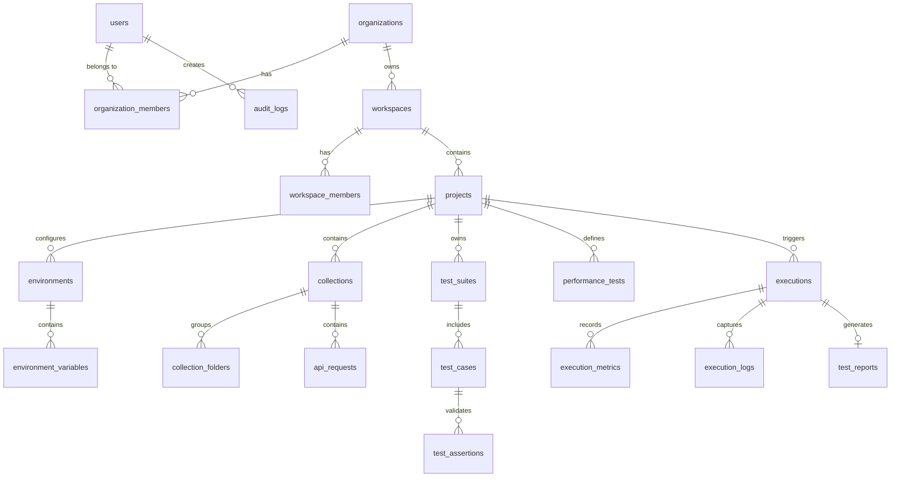

# ALPINEX — Database Schema, ERD & Migration Strategy

## 1. Entity-Relationship Diagram (ERD)



---

## 2. Relational Table Specifications

### 2.1 Identity & Governance Tables
```sql
CREATE TABLE users (
    id UUID PRIMARY KEY DEFAULT gen_random_uuid(),
    email VARCHAR(255) UNIQUE NOT NULL,
    password_hash VARCHAR(255) NOT NULL,
    full_name VARCHAR(255) NOT NULL,
    system_role VARCHAR(50) NOT NULL DEFAULT 'USER', -- SUPER_ADMIN, USER
    status VARCHAR(50) NOT NULL DEFAULT 'ACTIVE',    -- ACTIVE, INACTIVE, SUSPENDED
    created_at TIMESTAMPTZ NOT NULL DEFAULT NOW(),
    updated_at TIMESTAMPTZ NOT NULL DEFAULT NOW()
);

CREATE TABLE organizations (
    id UUID PRIMARY KEY DEFAULT gen_random_uuid(),
    name VARCHAR(255) NOT NULL,
    slug VARCHAR(255) UNIQUE NOT NULL,
    created_at TIMESTAMPTZ NOT NULL DEFAULT NOW(),
    updated_at TIMESTAMPTZ NOT NULL DEFAULT NOW()
);

CREATE TABLE organization_members (
    organization_id UUID REFERENCES organizations(id) ON DELETE CASCADE,
    user_id UUID REFERENCES users(id) ON DELETE CASCADE,
    role VARCHAR(50) NOT NULL DEFAULT 'MEMBER', -- OWNER, ADMIN, MEMBER
    joined_at TIMESTAMPTZ NOT NULL DEFAULT NOW(),
    PRIMARY KEY (organization_id, user_id)
);

CREATE TABLE workspaces (
    id UUID PRIMARY KEY DEFAULT gen_random_uuid(),
    organization_id UUID REFERENCES organizations(id) ON DELETE CASCADE,
    name VARCHAR(255) NOT NULL,
    description TEXT,
    created_at TIMESTAMPTZ NOT NULL DEFAULT NOW(),
    updated_at TIMESTAMPTZ NOT NULL DEFAULT NOW()
);

CREATE TABLE projects (
    id UUID PRIMARY KEY DEFAULT gen_random_uuid(),
    workspace_id UUID REFERENCES workspaces(id) ON DELETE CASCADE,
    name VARCHAR(255) NOT NULL,
    description TEXT,
    created_at TIMESTAMPTZ NOT NULL DEFAULT NOW(),
    updated_at TIMESTAMPTZ NOT NULL DEFAULT NOW(),
    UNIQUE (workspace_id, name)
);
```

### 2.2 Environment & Secrets Tables
```sql
CREATE TABLE environments (
    id UUID PRIMARY KEY DEFAULT gen_random_uuid(),
    project_id UUID REFERENCES projects(id) ON DELETE CASCADE,
    name VARCHAR(100) NOT NULL, -- Development, Staging, Production
    description TEXT,
    created_at TIMESTAMPTZ NOT NULL DEFAULT NOW(),
    updated_at TIMESTAMPTZ NOT NULL DEFAULT NOW(),
    UNIQUE (project_id, name)
);

CREATE TABLE environment_variables (
    id UUID PRIMARY KEY DEFAULT gen_random_uuid(),
    environment_id UUID REFERENCES environments(id) ON DELETE CASCADE,
    key VARCHAR(255) NOT NULL,
    value TEXT NOT NULL,         -- Plaintext for normal, ciphertext for secrets
    is_secret BOOLEAN NOT NULL DEFAULT FALSE,
    created_at TIMESTAMPTZ NOT NULL DEFAULT NOW(),
    updated_at TIMESTAMPTZ NOT NULL DEFAULT NOW(),
    UNIQUE (environment_id, key)
);
```

### 2.3 API Workspace & Collections Tables
```sql
CREATE TABLE collections (
    id UUID PRIMARY KEY DEFAULT gen_random_uuid(),
    project_id UUID REFERENCES projects(id) ON DELETE CASCADE,
    name VARCHAR(255) NOT NULL,
    description TEXT,
    created_at TIMESTAMPTZ NOT NULL DEFAULT NOW(),
    updated_at TIMESTAMPTZ NOT NULL DEFAULT NOW()
);

CREATE TABLE collection_folders (
    id UUID PRIMARY KEY DEFAULT gen_random_uuid(),
    collection_id UUID REFERENCES collections(id) ON DELETE CASCADE,
    parent_folder_id UUID REFERENCES collection_folders(id) ON DELETE CASCADE,
    name VARCHAR(255) NOT NULL,
    position INT NOT NULL DEFAULT 0
);

CREATE TABLE api_requests (
    id UUID PRIMARY KEY DEFAULT gen_random_uuid(),
    collection_id UUID REFERENCES collections(id) ON DELETE CASCADE,
    folder_id UUID REFERENCES collection_folders(id) ON DELETE SET NULL,
    name VARCHAR(255) NOT NULL,
    method VARCHAR(20) NOT NULL,
    url_template TEXT NOT NULL,
    headers JSONB NOT NULL DEFAULT '[]'::jsonb,
    query_params JSONB NOT NULL DEFAULT '[]'::jsonb,
    body_type VARCHAR(50) NOT NULL DEFAULT 'NONE', -- JSON, XML, FORM, RAW
    body_content TEXT,
    auth_config JSONB NOT NULL DEFAULT '{}'::jsonb,
    timeout_ms INT NOT NULL DEFAULT 30000,
    position INT NOT NULL DEFAULT 0,
    created_at TIMESTAMPTZ NOT NULL DEFAULT NOW(),
    updated_at TIMESTAMPTZ NOT NULL DEFAULT NOW()
);
```

### 2.4 Functional & Performance Testing Tables
```sql
CREATE TABLE test_suites (
    id UUID PRIMARY KEY DEFAULT gen_random_uuid(),
    project_id UUID REFERENCES projects(id) ON DELETE CASCADE,
    name VARCHAR(255) NOT NULL,
    description TEXT,
    stop_on_failure BOOLEAN NOT NULL DEFAULT FALSE,
    created_at TIMESTAMPTZ NOT NULL DEFAULT NOW(),
    updated_at TIMESTAMPTZ NOT NULL DEFAULT NOW()
);

CREATE TABLE test_cases (
    id UUID PRIMARY KEY DEFAULT gen_random_uuid(),
    suite_id UUID REFERENCES test_suites(id) ON DELETE CASCADE,
    request_id UUID REFERENCES api_requests(id) ON DELETE SET NULL,
    name VARCHAR(255) NOT NULL,
    position INT NOT NULL DEFAULT 0,
    variable_extractions JSONB NOT NULL DEFAULT '[]'::jsonb, -- JSONPath -> var
    created_at TIMESTAMPTZ NOT NULL DEFAULT NOW()
);

CREATE TABLE test_assertions (
    id UUID PRIMARY KEY DEFAULT gen_random_uuid(),
    test_case_id UUID REFERENCES test_cases(id) ON DELETE CASCADE,
    source VARCHAR(50) NOT NULL,      -- STATUS, RESPONSE_TIME, JSON_PATH, HEADER, BODY
    operator VARCHAR(50) NOT NULL,    -- EQUALS, LESS_THAN, CONTAINS, EXISTS, REGEX
    target_value TEXT NOT NULL,
    property_path TEXT               -- For JSONPath or header key
);

CREATE TABLE performance_tests (
    id UUID PRIMARY KEY DEFAULT gen_random_uuid(),
    project_id UUID REFERENCES projects(id) ON DELETE CASCADE,
    name VARCHAR(255) NOT NULL,
    test_type VARCHAR(50) NOT NULL,   -- SMOKE, LOAD, STRESS, SPIKE, SOAK
    workload_profile JSONB NOT NULL,  -- VUs, stages, arrival_rate
    scenarios JSONB NOT NULL,         -- Steps, weights, think_time
    thresholds JSONB NOT NULL,        -- p95 < 500, error_rate < 0.01
    custom_script TEXT,               -- Custom k6 script (if script editor mode)
    created_at TIMESTAMPTZ NOT NULL DEFAULT NOW(),
    updated_at TIMESTAMPTZ NOT NULL DEFAULT NOW()
);
```

### 2.5 Execution & Telemetry Tables
```sql
CREATE TABLE executions (
    id UUID PRIMARY KEY DEFAULT gen_random_uuid(),
    project_id UUID REFERENCES projects(id) ON DELETE CASCADE,
    test_type VARCHAR(50) NOT NULL,          -- FUNCTIONAL, PERFORMANCE
    target_id UUID NOT NULL,                 -- test_suite_id or performance_test_id
    environment_id UUID REFERENCES environments(id) ON DELETE SET NULL,
    triggered_by UUID REFERENCES users(id) ON DELETE SET NULL,
    engine VARCHAR(50) NOT NULL,             -- NATIVE_HTTP, K6
    status VARCHAR(50) NOT NULL DEFAULT 'QUEUED', -- QUEUED, RUNNING, COMPLETED, FAILED, CANCELLED
    configuration_snapshot JSONB NOT NULL,
    started_at TIMESTAMPTZ,
    ended_at TIMESTAMPTZ,
    created_at TIMESTAMPTZ NOT NULL DEFAULT NOW()
);

CREATE INDEX idx_executions_project_status ON executions(project_id, status);
CREATE INDEX idx_executions_started_at ON executions(started_at DESC);

CREATE TABLE execution_metrics (
    id BIGSERIAL PRIMARY KEY,
    execution_id UUID REFERENCES executions(id) ON DELETE CASCADE,
    timestamp TIMESTAMPTZ NOT NULL,
    vus INT NOT NULL DEFAULT 0,
    rps DOUBLE PRECISION NOT NULL DEFAULT 0.0,
    latency_p50 DOUBLE PRECISION,
    latency_p90 DOUBLE PRECISION,
    latency_p95 DOUBLE PRECISION,
    latency_p99 DOUBLE PRECISION,
    latency_avg DOUBLE PRECISION,
    error_rate DOUBLE PRECISION NOT NULL DEFAULT 0.0
);

CREATE INDEX idx_exec_metrics_exec_time ON execution_metrics(execution_id, timestamp);

CREATE TABLE test_reports (
    id UUID PRIMARY KEY DEFAULT gen_random_uuid(),
    execution_id UUID UNIQUE REFERENCES executions(id) ON DELETE CASCADE,
    verdict VARCHAR(50) NOT NULL,     -- PASSED, FAILED, INCONCLUSIVE
    summary_metrics JSONB NOT NULL,
    threshold_results JSONB NOT NULL,
    generated_at TIMESTAMPTZ NOT NULL DEFAULT NOW()
);

CREATE TABLE audit_logs (
    id BIGSERIAL PRIMARY KEY,
    user_id UUID REFERENCES users(id) ON DELETE SET NULL,
    action VARCHAR(100) NOT NULL,
    resource_type VARCHAR(100) NOT NULL,
    resource_id VARCHAR(255) NOT NULL,
    payload JSONB,
    ip_address VARCHAR(45),
    created_at TIMESTAMPTZ NOT NULL DEFAULT NOW()
);

CREATE INDEX idx_audit_logs_created_at ON audit_logs(created_at DESC);
```

---

## 3. Database Migration Strategy

1. **Tooling:** We employ `golang-migrate/migrate` with raw SQL scripts embedded into the Go binary (`//go:embed migrations/*.sql`).
2. **Naming Convention:** Sequential integer timestamping:
   - `000001_initial_schema.up.sql` / `000001_initial_schema.down.sql`
   - `000002_add_indexes.up.sql` / `000002_add_indexes.down.sql`
3. **Execution Policy:**
   - On service startup (`cmd/api`), migrations execute automatically up to latest.
   - CLI command `alpinex migrate up` and `alpinex migrate down` available for manual orchestration in CI/CD and production environments.
