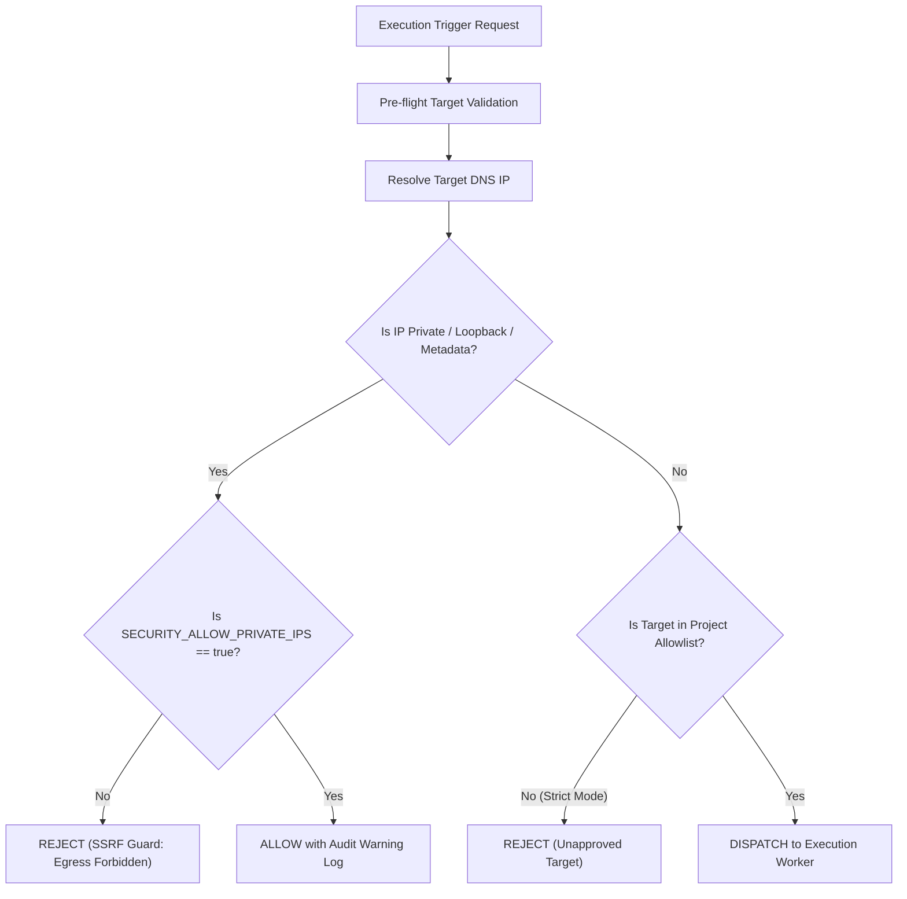

# ALPINEX — Security & Responsible Load Testing Specification

## 1. STRIDE Threat Model

| Threat Category | Potential Attack Vector | ALPINEX Defense Mechanism |
|---|---|---|
| **Spoofing** | Forged JWT tokens or impersonated worker heartbeats | RS256/HS256 cryptographic signature validation; worker mutual pre-shared tokens (`WORKER_AUTH_SECRET`). |
| **Tampering** | Modification of test results or audit records | Append-only audit logs; immutable completed execution reports with integrity hash. |
| **Repudiation** | User denies triggering high-impact load test | Comprehensive audit trail logging initiator ID, target URL, timestamp, client IP, and exact workload. |
| **Information Disclosure** | Leakage of API tokens, production passwords, or cloud secrets | AES-256-GCM encryption at rest; UI masking (`********`); automatic redaction from logs and test reports. |
| **Denial of Service** | Rogue user running unbounded VUs against unauthorized targets | Target URL authorization check; quota enforcement (`max_vus`, `max_duration`); admin emergency kill-switch. |
| **Elevation of Privilege** | Normal tester accessing admin platform settings or other orgs | Multi-tenant RBAC enforced in the Go application core; tenant isolation checks on every aggregate query. |

---

## 2. SSRF Prevention & Network Egress Control

Under PRD Section 11.2 & 11.3, load generators can inadvertently cause internal network disruption or cloud metadata exfiltration (`http://169.254.169.254`).

### Prohibited Destination Ranges (Production Default)
- `127.0.0.0/8` (Loopback)
- `10.0.0.0/8`, `172.16.0.0/12`, `192.168.0.0/16` (RFC 1918 Private Networks)
- `169.254.0.0/16` (Link-local & AWS/GCP/Azure Metadata Services)
- `::1/128`, `fc00::/7` (IPv6 loopback & Unique Local Addresses)

---

## 3. RBAC Permissions Matrix

| Permission | Super Admin | Org Owner | Project Admin | Developer | Tester | Viewer |
|---|:---:|:---:|:---:|:---:|:---:|:---:|
| `platform.settings.manage` | ✅ | ❌ | ❌ | ❌ | ❌ | ❌ |
| `organization.manage` | ✅ | ✅ | ❌ | ❌ | ❌ | ❌ |
| `workspace.manage` | ✅ | ✅ | ❌ | ❌ | ❌ | ❌ |
| `project.create` | ✅ | ✅ | ✅ | ❌ | ❌ | ❌ |
| `collection.manage` | ✅ | ✅ | ✅ | ✅ | ❌ | ❌ |
| `request.execute_single` | ✅ | ✅ | ✅ | ✅ | ✅ | ❌ |
| `functional.suite.manage` | ✅ | ✅ | ✅ | ✅ | ✅ | ❌ |
| `performance.test.manage` | ✅ | ✅ | ✅ | ✅ | ✅ | ❌ |
| `execution.trigger` | ✅ | ✅ | ✅ | ✅ | ✅ | ❌ |
| `execution.cancel_own` | ✅ | ✅ | ✅ | ✅ | ✅ | ❌ |
| `execution.cancel_any` | ✅ | ✅ | ✅ | ❌ | ❌ | ❌ |
| `report.view` | ✅ | ✅ | ✅ | ✅ | ✅ | ✅ |
| `report.export` | ✅ | ✅ | ✅ | ✅ | ✅ | ✅ |
| `secret.view_decrypted` | ✅ | ✅ | ✅ | ❌ | ❌ | ❌ |

---

## 4. Workload Quotas & Administrator Emergency Controls

1. **System Default Quotas:**
   - Default Max VUs per Execution: 1,000 (configurable via `QUOTA_MAX_VUS`).
   - Default Max Duration: 60 minutes (configurable via `QUOTA_MAX_DURATION_MINUTES`).
   - Max Concurrent Executions: 5 per workspace.
2. **Emergency Kill-Switch:**
   - REST Endpoint: `POST /api/v1/admin/executions/kill-all`
   - Super Admin can immediately broadcast an abort signal across all active workers to terminate all running load tests within 3 seconds.
