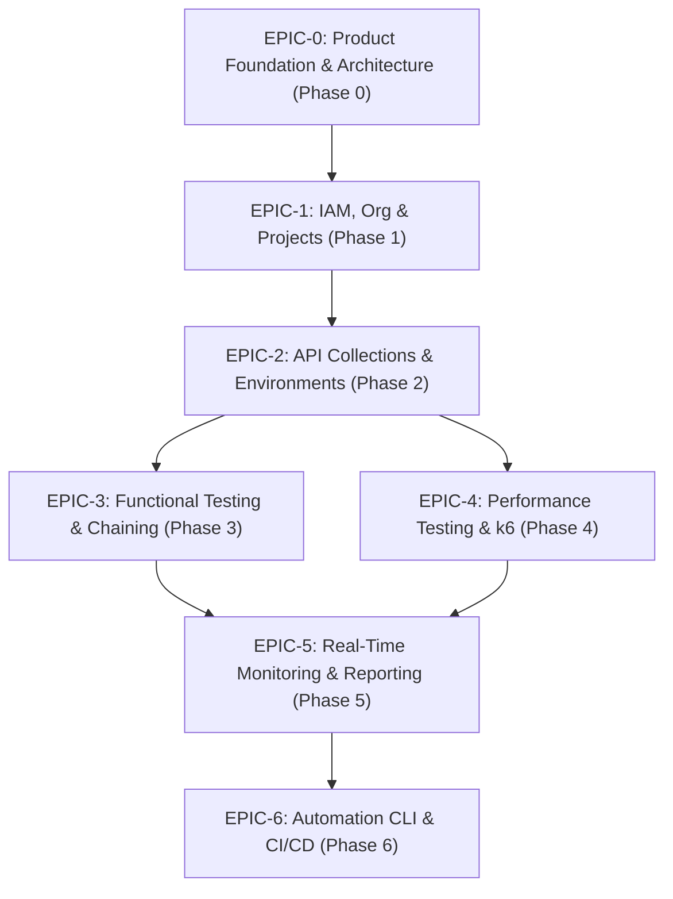

# ALPINEX — Jira Task Breakdown, Mandays Estimation & Roadmap

## 1. Jira Epics & Story Breakdown

### Epic Breakdown

| Epic ID | Epic Title | User Stories Included |
|---|---|---|
| **ALPX-E0** | Architecture & Project Foundation | Gap Analysis, C4 Design, Clean Arch Layout, Docker Baseline |
| **ALPX-E1** | Identity, Organization & Workspace | FR-IAM-001 (Auth), FR-IAM-002 (RBAC), FR-ORG-001, FR-WS-001, FR-PROJ-001 |
| **ALPX-E2** | API Workspace & Environment Management | FR-API-001 (Builder), FR-API-002 (Viewer), FR-API-003 (Collections), FR-ENV-001/002/003 |
| **ALPX-E3** | Functional Testing & Chaining | FR-FUNC-001 (Test Cases), FR-FUNC-002 (Assertions), FR-FUNC-003 (Suites), FR-FUNC-004 (Chaining) |
| **ALPX-E4** | Performance Testing & k6 Engine | FR-PERF-001 (Designer), FR-PERF-003 (Workload), FR-PERF-005 (Thresholds), FR-EXEC-001 (k6 Adapter) |
| **ALPX-E5** | Real-Time Monitoring & Reports | FR-MON-001 (Live Dash), FR-REPORT-001 (History), FR-REPORT-002 (Report), FR-REPORT-003 (Comparison) |
| **ALPX-E6** | CLI & CI/CD Automation | FR-AUTO-001 (CLI), FR-AUTO-002 (Execution API), FR-AUTO-003 (Pipeline Exit Codes) |

---

## 2. Mandays Estimation

| Phase / Module | Backend (Go) | Frontend (React/TS) | QA / Perf Testing | DevOps / Infra | Total Mandays |
|---|:---:|:---:|:---:|:---:|:---:|
| **Phase 0: Foundation & Design** | 3 days | 2 days | 2 days | 2 days | **9 days** |
| **Phase 1: IAM, Org & Projects** | 6 days | 5 days | 3 days | 1 day | **15 days** |
| **Phase 2: API Workspace & Collections** | 7 days | 8 days | 3 days | 1 day | **19 days** |
| **Phase 3: Functional Testing Engine** | 8 days | 6 days | 5 days | 1 day | **20 days** |
| **Phase 4: Performance Testing & k6** | 10 days | 7 days | 6 days | 2 days | **25 days** |
| **Phase 5: Monitoring & Reports** | 7 days | 8 days | 4 days | 1 day | **20 days** |
| **Phase 6: CLI & CI/CD** | 5 days | 2 days | 3 days | 2 days | **12 days** |
| **Total Project Mandays** | **46 days** | **38 days** | **26 days** | **10 days** | **120 days** |

---

## 3. Implementation Sequence & Phase Release Gates

### Sequence Steps:
1. **Gate 0 (Current Step):** Design Approval Gate. Complete design artifacts 1-22 reviewed; open questions resolved; repository foundation established.
2. **Phase 1:** Core IAM, Database Schema Migrations, Redis queue connection, Project scoping.
   - *Exit Gate 1:* User can register/login, create workspaces and projects via API and Web UI.
3. **Phase 2:** API Request builder, header/query editor, collection hierarchical folders, environment variable resolver.
   - *Exit Gate 2:* User can save collections, switch environments, and execute live single-shot HTTP requests.
4. **Phase 3:** Functional Test Suite runner (Go native HTTP engine), JSONPath and status assertions, chaining output to input.
   - *Exit Gate 3:* Multi-step login flow tests pass deterministically with assertions logged.
5. **Phase 4:** Performance Scenario builder, k6 JS script synthesis from domain model, k6 worker subprocess wrapper, safe workload bounds.
   - *Exit Gate 4:* User can run a 50 VU load test against a sample service with k6 streaming metrics.
6. **Phase 5:** WebSocket metric broadcaster, Web UI dashboard with response time percentiles (P50/P90/P95/P99), historical run comparison, HTML report export.
   - *Exit Gate 5:* Live charts update at 1s intervals; completed runs freeze into exportable reports.
7. **Phase 6:** `alpinex` CLI binary with `test run` and `performance run` commands, CI exit codes (0/1/2/3).
   - *Exit Gate 6:* GitHub Actions workflow executes tests via CLI and uploads test report artifact.
