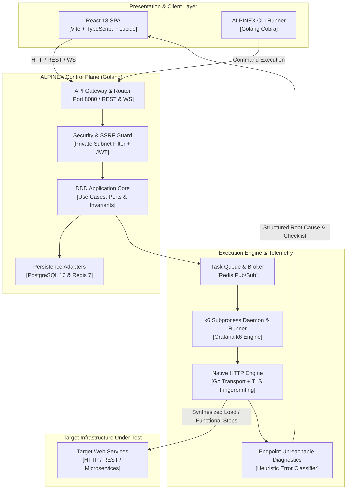
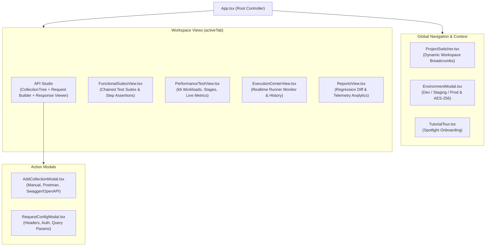
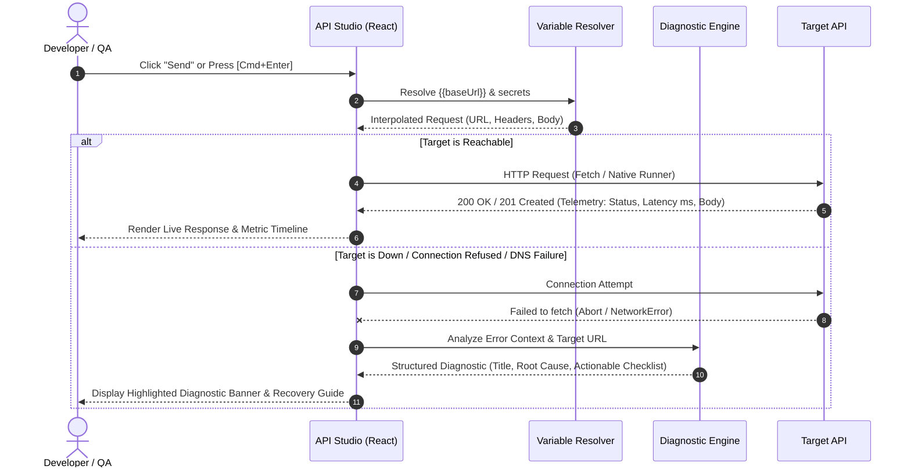

# ALPINEX — System Architecture & Code Alignment Specification
> **Document Code: DOC-ARCH-08**  
> **Author:** Fred (System Architect) — BMAD Method  
> **Status:** Approved & Aligned with Codebase v1.1.0  
> **Target Audience:** Engineering, Product, QA, Architecture Review Board  

---

## 1. Executive Summary & Architecture Intent

The primary purpose of this specification is to eliminate any architectural and design drift between the system design blueprints (PRD & Clean Architecture specifications in `docs/01-07`) and the actual implementation of ALPINEX v1.1.0.

ALPINEX unifies two foundational architectural paradigms:
1. **Domain-Driven Design (DDD) & Clean Architecture (Hexagonal)** on the Go Control Plane and Execution Engine.
2. **Component-Driven Modular Architecture & Scoped State Isolation** on the React/TypeScript Frontend Studio.

---

## 2. End-to-End System Context & Topology

---

## 3. Frontend Component & State Architecture (Web Studio)

The React SPA is structured into modular views, decoupled modals, and isolated state domains to ensure deterministic test configuration and zero cross-project variable leakage.

### 3.1 Component Hierarchy Map

### 3.2 State Scoping & Multi-Tenancy Invariant

To prevent cross-project contamination:
* **Project Scoping:** All API collections and functional suites are persisted to client storage using namespaced keys:
  $$\text{Key} = \texttt{alpinex\_collections\_} + \text{activeProject.id}$$
* **Environment Scoping:**
  * Active Environment (`dev`, `staging`, `prod`) injects variables through variable interpolation before execution:
    $$\text{URL}_{\text{resolved}} = \text{Interpolate}(\text{URL}_{\text{template}}, \text{ActiveEnvVariables}, \text{CollectionBaseUrl})$$
  * **Production Safety Guard:** Any destructive action (`POST`, `PUT`, `DELETE`, `PATCH`) triggered against an environment marked as `prod` raises an explicit confirmation dialogue.

---

## 4. Execution & Diagnostic Engine Flow

When a user executes an API request, functional step, or k6 performance scenario:

---

## 5. Traceability Matrix: PRD vs Architecture vs Codebase

| Feature / Domain Module | PRD Section | Architectural Document | Codebase Implementation (v1.1.0) | Status |
|---|---|---|---|---|
| **Identity & Access Management** | PRD §6.1 | `docs/02-domain-driven-design.md` §3.1 | `internal/core/domain/iam/`, `web/src/components/LoginPage.tsx` | **Aligned** |
| **Workspace & Multi-Tenancy** | PRD §6.2 | `docs/02-domain-driven-design.md` §3.1 | `internal/core/domain/workspace/`, `web/src/components/ProjectSwitcher.tsx` | **Aligned** |
| **API Studio & Importers** | PRD §6.3 | `docs/03-c4-architecture-and-clean-architecture.md` | `web/src/components/CollectionTree.tsx`, `AddCollectionModal.tsx`, `importers.ts` | **Aligned** |
| **Environment & Secrets** | PRD §6.4 | `docs/02-domain-driven-design.md` §3.2 | `internal/core/domain/environment/`, `web/src/components/EnvironmentModal.tsx` | **Aligned** |
| **Functional Test Suites** | PRD §6.5 | `docs/02-domain-driven-design.md` §3.3 | `internal/core/domain/functional/`, `web/src/components/FunctionalSuitesView.tsx` | **Aligned** |
| **Performance Engineering (k6)** | PRD §6.6 | `docs/03-c4-architecture-and-clean-architecture.md` §4 | `internal/adapters/engines/k6/`, `web/src/components/PerformanceTestView.tsx` | **Aligned** |
| **Execution Diagnostics** | PRD §6.7 | `docs/08-system-architecture-and-code-alignment.md` §4 | `web/src/components/ExecutionCenterView.tsx`, `web/src/App.tsx` | **Aligned** |
| **E2E Quality Assurance** | PRD §8 | `docs/08-system-architecture-and-code-alignment.md` §6 | `web/e2e/` (Playwright automated test suites) | **In Progress** |

---

## 6. Architectural Rules & Engineering Invariants

1. **Clean Architecture Boundary:** Web presentation components must never bypass domain variable resolution or execute raw unscoped mutations.
2. **Deterministic Test Execution:** Every execution is assigned an immutable snapshot of environment variables and request definitions.
3. **Fail-Closed Diagnostics:** Any network failure must produce actionable diagnostic remediation steps rather than an empty `TypeError`.
4. **Automated Evidence Verification:** Every functional test and critical user path must have automated visual screenshot evidence validating system health.
